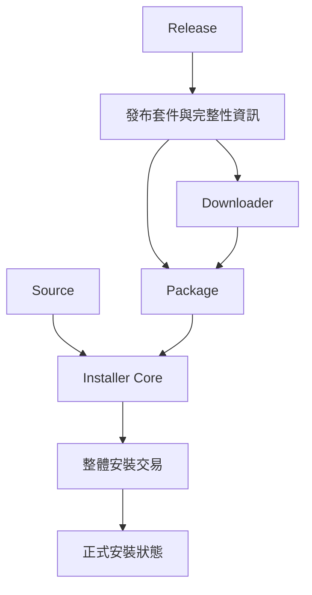

# Release 安裝器架構規範

## 1. 架構定位

本文件定義安裝器的目標架構、職責、邊界、資料流及必要約束，供維護安裝器時遵循，不描述目前實作的完成程度，不限制實體模組結構、程式語言或儲存方式。使用者操作見 [Release 安裝指引](../../docs/release/README.md)。

## 2. 安裝入口與封裝

1. 各支援平台遵循相同的安裝選項、狀態及行為契約；Host 專屬的安裝位置、指令及設定由 Host 差異處理，不混用不同 Host 的安裝內容與狀態。
2. Release 負責發布版本管理、binary 建置、套件封裝、資產驗證及發布；每個發布套件獨立對應單一版本、Host 與平台。Installer 負責取得、驗證及安裝資源，不負責發布或封裝 Release 資產。
3. Release 與 Installer 透過共用套件契約銜接；套件提供完整安裝資源、版本、Host、平台及必要完整性資訊，雙方不依賴彼此內部實作。
4. 安裝資源分為 Runtime Skill（Work、Tooling 的領域 Markdown 指令）、Shared 共用指令資源（`skills/shared/bootstrap.md` 及實際存在的 `bootstrap/` Modules）、共用 Runtime CLI（Work CLI、Skill CLI）及選用 Global Instructions。Shared 不屬於獨立 Skill，不含 `SKILL.md`；兩個 Skill 使用同一組安裝的 Shared，不各自封裝或安裝副本。CLI 與 Skill 分離，不在各 Skill 內安裝專屬 binary，不再封裝或安裝 Tooling Binary、Contract Skill。各 Host 依啟用 Skill 的入口與有效安裝資訊解析同組 Shared 及正確 CLI 入口，不要求固定實體目錄或 PATH 配置，也不得任意混用其他安裝的版本、資源或 Host。

| 入口 | 職責 |
| --- | --- |
| Source | 從同一原始碼樹取得版本、Skill、Shared、Global Instructions 並建置所需 binary，不依賴已發布套件。 |
| Package | 使用套件中的預編譯 binary 和其他資源，驗證套件完整性、版本、Host、平台及 binary 後交給安裝核心。 |
| Downloader | 從入口所屬的固定 Release tag 取得所選 Host 與平台的套件，驗證外部 SHA-256 及下載內容後委派 Package；原樣保留安裝選項的引數順序與邊界，不重複實作安裝邏輯。 |

Source 與 Package 共用該平台的安裝核心，遵循相同的安裝交易與狀態契約。

### 2.1 安裝根目錄與 Host 探索邊界

1. 公開安裝位置參數為 `--install-dir`，不再支援 `--skills-dir`。Codex 預設 `~/.agents/agent-work-kit`、Claude Code 預設 `~/.claude/agent-work-kit`；使用者只可自訂整體實體安裝根目錄，未指定時不從舊連結反向推導。
2. `install_dir` 是單一管理根目錄：`skills/{work,tooling,shared}`、`bin/{work,skill}`、`install-state.json`。Skill CLI 的 `--install` 應指向 `install_dir/skills`。Release ZIP 根目錄的 README 不安裝到此根目錄。
3. Host 探索目錄固定於 Codex `~/.agents/skills` 或 Claude Code `~/.claude/skills`；只為 Work、Tooling 建立絕對目標探索連結，不為 Shared 建立獨立 Host Skill 入口。macOS 使用 Directory Symbolic Link；Windows 僅使用 Directory Junction，不依賴管理員權限或 Developer Mode，不使用其他 fallback、不遷移既有 Symbolic Link。
4. Host Skills 目錄中的第三方 Skill（包括外部連結）不屬於本套件來源、Manifest 或交易範圍；Installer 僅管理經驗證的 Work／Tooling 探索入口。不得放寬 `install_dir/skills` 內各來源與非法連結的拒絕規則。
5. 初次安裝僅在探索入口未占用時建立連結；重新安裝驗證後沿用既有連結，缺失、損毀或目標不符則拒絕，不自行修復。Installer 不修改 Host 原生探索設定，也不把模擬探索宣稱為真實 Host 實測。

### 2.2 互動式結束

1. Windows／macOS 的 Source、Package、Downloader 互動式安裝在成功、失敗、取消及 Dry Run 結束時，均保留最終訊息並等待使用者確認；非互動、無可用互動輸入及 CI 不暫停。
2. 僅最外層入口負責暫停一次；Downloader 委派 Package 不改變其互動選擇。暫停之前完成交易處理、安全清理及解鎖；保留原始訊息及 Exit Code，不增加公開參數。
3. Windows／macOS 的權限驗收共用單一代表性 Codex Package Smoke Test：以實際非管理員身分完成預設位置首次安裝、Global Instructions、探索連結／正式狀態／CLI 驗證及重新安裝。Windows 使用臨時本機 Standard User 與實際 User Profile，Developer Mode 關閉；macOS 使用既有非管理員 UID 與獨立臨時 Home，不要求另外建立登入帳號。管理員僅負責環境準備、身分切換及清理，Installer 不提權；不以模擬權限取代。

## 3. 安裝核心

安裝核心統籌安裝交易與邏輯職責的協作，不重複各職責的內部邏輯。

| 邏輯職責 | 責任 |
| --- | --- |
| CLI 與設定 | 依共用選項契約解析引數、決定 Host 與安裝位置，取得必要的安裝選擇及確認。 |
| 目標預檢 | 驗證環境、版本、既有狀態與實際內容、目標安全性及正在使用的 binary；保留未知或不安全內容並拒絕接管。 |
| 安裝資源 | 準備並驗證完整的 Work／Tooling Skill、Shared、Work／Skill CLI 及已啟用的 Global Instructions 資源，處理 Host 差異、Shared 與 CLI 入口及各元件自身的安裝操作與結果驗證。 |
| 交易管理 | 統籌使用者層級互斥、交易生命週期、整體提交及失敗處理。 |
| 狀態管理 | 統一驗證、管理正式安裝狀態及必要的交易暫存資訊。 |

Global Instructions 未啟用時，不參與其目標檢查或安裝交易；啟用時，取代既有內容須符合使用者授權。預覽安裝不得修改正式安裝目標。不得刪除或覆蓋無法確認歸屬或與本次安裝無關的資料。Shared 為本套件管理的共用資源，不得因同名目錄即認定其所有權；來源或目標含未知內容、來源邊界不明或與其他 Skill／套件衝突時，依安全預檢拒絕不安全的接管。

## 4. 安裝交易

1. 每次安裝是一個整體交易，Work／Tooling Skill、Shared、Work／Skill CLI 與首次建立的 Work／Tooling Host 探索連結必須共同安裝；Global Instructions 啟用時納入同一交易。各元件只是交易參與者，不得獨立安裝或提交。
2. 安裝器定位為個人使用者安裝工具。僅以作業系統實際使用者身分（Windows SID、macOS UID）取得單一原生安裝鎖；同一使用者跨 Host、安裝目標及登入 Session 互斥，不同使用者使用各自獨立的安裝資源時可並行。鎖定涵蓋可變狀態預檢、復原、交易與清理；取得失敗安全拒絕，正常或異常退出後依原生鎖生命週期釋放。不支援不同使用者共用同一實體安裝根目錄、Host 探索目錄或 Global Instructions 目標，不提供跨使用者目標鎖或產品級帳號隔離；資源存取權限由作業系統管理。
3. 採用邏輯原子性，允許分階段寫入，但未提交的中間狀態不得視為有效安裝或供相依工作使用。所有必要資源及正式安裝結果通過驗證後，才能統一提交。

| 邏輯階段 | 職責 |
| --- | --- |
| Preflight | 確認環境、既有狀態、安裝目標及必要授權，不修改正式安裝內容。 |
| Prepare | 準備並驗證所有參與者的安裝資源及必要的交易資訊，不修改正式安裝內容。 |
| Apply | 將已驗證的資源寫入正式安裝目標。 |
| Verify | 驗證所有參與者的實際安裝結果及整體一致性。 |
| Commit | 統一提交正式安裝狀態，確認提交成功後才視為安裝完成。 |

以上為邏輯階段，可依實作需要組織，但不得破壞其職責、必要相依順序及約束。

安裝根目錄與 Host Skills 探索目錄可能分屬不同磁碟；交易與復原不得依賴跨磁碟原子移動。Windows 無法建立 Junction 時安全拒絕，不自行提權或修改系統安全設定；移除 Junction 時不得跟隨或刪除目標。正式寫入前失敗須保留原有安裝；正式寫入後失敗或中斷，由整體交易統一處理並保留必要的復原資訊。未完成的交易不得宣告成功；無法安全處理時保留現況並回報原因。須具備安全復原能力，不強制 Rollback、Resume 或獨立復原機制。

## 5. 安裝狀態

1. 每組安裝的正式狀態僅有一個權威來源，對應 Runtime CLI、Shared、Skill 的同一組有效安裝及 Host。所有正式狀態及必要暫存資訊由整體交易集中管理，各元件不得獨立管理或提交安裝狀態。
2. Source、Package 與各平台遵循共用狀態契約。唯一狀態檔位於 `install_dir/install-state.json`，僅以 `install_dir` 記錄實體安裝根路徑，取代 `skill_install_dir` 與 `cli_install_dir`；保留 Host、整體發布版本、Rust workspace 版本、Global Instructions、完成狀態及受管理檔案 Manifest，不增加 `host_skills_dir` 或連結專用欄位。位置與連結目標均須能推導並驗證。
3. 發布版本以根目錄 VERSION 為準；Rust workspace 版本以 Cargo workspace 的版本為準，兩者不得混用。安裝狀態、發布套件與 Work／Skill CLI 的 Rust host 中繼資料須使用一致的 Rust workspace 版本語意。
4. 暫存資訊僅供交易判斷及必要復原使用，不是正式安裝狀態；完成後清理不再需要的交易資訊。狀態檔存在不代表安裝有效，須同時驗證實際安裝內容。
5. 重新安裝時僅沿用同一 Host 的有效既有設定，明確的使用者選擇優先。目標目錄不存在或為空且無既有安裝時視為首次安裝，預設啟用 Global Instructions；目標已有內容但無有效狀態時，保留原內容並拒絕接管，但已確認屬於未完成交易的內容可依交易失敗處理原則安全處理。

## 6. 安裝驗證

1. Source 與 Package 須依相同資源契約安裝；驗證各支援平台及 Host 的 Work／Tooling Skill、Shared、Work／Skill CLI、契約查詢入口、安裝狀態及實際 Shared／CLI 解析的一致性。Shared 必須有唯一共用 Bootstrap，僅安裝實際存在的 Modules，且不被當成獨立 Skill；驗證兩個 Skill 均可從同一組有效安裝獨立解析、使用 Shared 及所需 CLI，拒絕混用其他安裝或無效資源，不依賴另一 Skill 或 Global Instructions 啟用。
2. 安裝器只支援現行安裝契約的首次安裝、重新安裝與失敗復原，不解析舊版安裝狀態，不提供升級、遷移或專用清理；沒有有效現行狀態的既有內容依第 5 節保留並拒絕接管。
3. 保留套件及下載資源的完整性驗證（含既有外部 SHA-256）、使用者層級互斥、邏輯原子性、狀態提交及安全復原。Skill／Work 不強制 Fingerprint 的設計不適用於此套件完整性契約。
4. 安裝鎖驗收限於同一使用者並行拒絕、正常退出後再次取得、異常退出後再次取得，以及實際 SID／UID 的輕量識別檢查；不新增跨使用者完整並行安裝 E2E、共用目標鎖或帳號隔離測試。保留既有安裝交易、路徑安全、跨磁碟安裝及非管理員權限驗收。
5. 一般 CI 繼續驗證三入口、雙 Host、安裝鎖、交易復原、自訂／跨本機磁碟、安全邊界及既有 Release E2E 網路隔離。權限 Smoke Test 不重複上述完整 E2E，不複製 Repository 或 Rust Toolchain／Cargo Registry，不執行 Rust 建置、IPC 專項預檢或非管理員 Source／Downloader E2E；只準備代表性正式 ZIP、Checksum 及共用測試必要模組。兩平台共用驗收邏輯，僅帳號／Home 準備及原生連結機制依平台而異。
