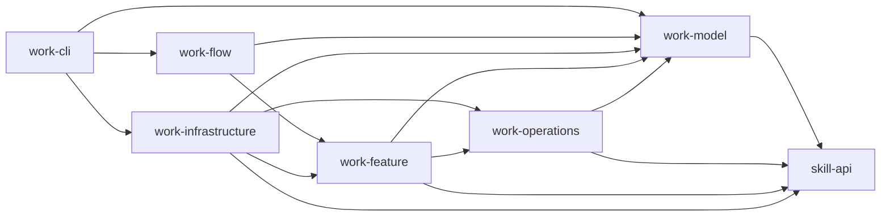
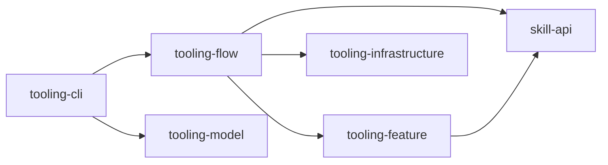
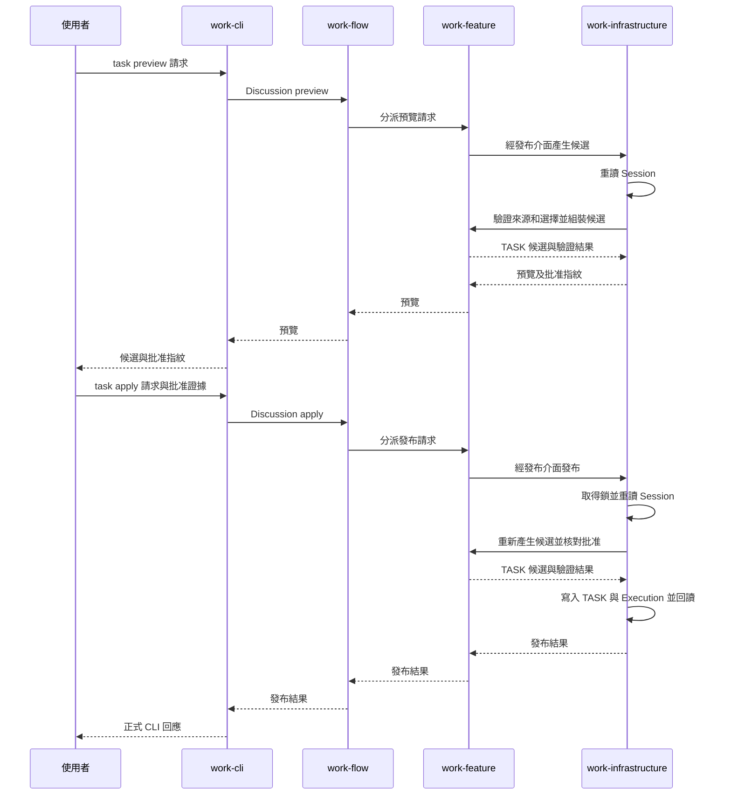

# Rust Workspace 架構規範

## Purpose

定義 Skill、Work、Tooling 的 crate 責任、依賴方向及公開資料邊界，供開發與維護時遵循。

## Requirements

本文件定義 Rust Workspace 的 Skill、Tooling、Work 三個領域及其公開入口，供開發與維護時判斷模組責任與依賴方向。模組與介面示例僅說明責任，不指定實際函式名稱。

Work 以 Model、Operations、Feature、Flow、Infrastructure 與 CLI 分離資料契約、純規則、業務功能、流程組合、外部能力及命令入口。Tooling 也有六個 crate；Model 定義 CLI 回應契約，現行業務實作集中在 Feature、Flow、Infrastructure 與 CLI，Operations 尚未承接公開業務能力。Skill 以 `skill-api` 提供函式庫公開入口，不提供 CLI。

### 領域責任與依賴

1. `rust/crates/skill/` 承接通用 Skill Discovery、Catalog、Metadata、Bootstrap、Instruction Loading、Hierarchy／References、通用 Selection／Validation、Bundle／Snapshot 及 Source／Fingerprint 能力。`skill-api` 組合 `skill-model`、`skill-operations`、`skill-feature`、`skill-infrastructure`，是其他領域唯一可直接依賴的 Skill crate。
2. `rust/crates/work/` 保有 TASK、Attempt、正式資料狀態查詢、Work Formal Instruction Selection、Work 專屬 Fingerprint、Authorization、Work Artifact／Immutable History 與 Recovery。六個 `work-*` crate 沿用下列內部層次，binary 名稱維持 `work`；Work 使用 Skill API，不重複實作通用 Skill 功能。
3. `rust/crates/tooling/` 的現行業務能力是政策來源驗證與操作目標邊界檢查。`tooling-cli` binary 為 `tooling`，公開 `policy discover`、`policy load`、`operation evaluate`，命令進入 `tooling-flow`。Host 提供選定分支、觀察、授權與語意審查結論，並自行執行工具；Tooling 不保存政策狀態或執行 Host 工具。
4. 領域依賴是 `work → skill-api ← tooling`。Skill 不依賴 Work 或 Tooling；Work 與 Tooling 彼此不依賴，且不直接依賴 Skill 內部 crate。`work` binary 只進入 Work 流程。通用 Skill Selection 與 Work Formal Selection 是不同權威。

### Crate 職責與依賴方向

Skill 的 `skill-model` 定義共用型別，`skill-operations` 實作純規則與指紋，`skill-feature` 組合 Catalog 與階層規則，`skill-infrastructure` 負責來源、Bundle 與 YAML 解析；`skill-api` 限定公開型別及操作。Tooling 的政策與 Host 證據型別、純規則分別屬於 `tooling-model` 與 `tooling-operations` 的目標責任；現行政策功能主要在 `tooling-feature`，目標邊界檢查在 `tooling-infrastructure`，`tooling-flow` 組合用例，`tooling-cli` 解析命令並映射 JSON 回應與退出碼。

公開 CLI 契約查詢由 `common/contract-core` 建置共用索引並提供查詢；Work 與 Tooling 的契約 JSON 仍由各自的 Model 資源目錄持有，命令樹仍由各自的 CLI 資源目錄持有。共用索引不承接領域 Validator、Host Routing 或授權判定。

Work 的每份契約紀錄保留在所屬領域目錄，並持有公開 ID、欄位清單、必要條件與 scaffold 資料。可獨立維護的大型 schema 放在同領域的 `schemas/`；大型完整 Example 快照放在同領域的 `fixtures/`，由 `example-policy.json` 排除於公開 Scenario。資源由只含 `$ref` 的物件引用，路徑以 `work-model/resources/contract/` 為基準；建置時展開引用，供既有 Model 回歸測試使用。小型 Example 保持內嵌並可公開；不得只為縮小檔案而切割單一字串或建立編號片段。JSON Schema 的 `#/$defs/...` 是 schema 內部引用，不作資源路徑處理。

Tooling 與 Work 透過 `skill-api` 讀取並驗證共用來源。Tooling 的政策差異與操作判定不進入 Skill；Work 的正式選取、Task／Attempt 與 Host 驗證不進入 Skill。兩個 CLI 輸出各自的公開契約。下表及 Work 圖描述 Work 的 crate 依賴；後面的 Tooling 小節描述 Tooling 的現行依賴及責任，不把尚未實作的層次當成現有呼叫路徑。

| Crate | 職責 | 允許直接依賴的其他 Work crate |
| --- | --- | --- |
| `work-model` | 定義資料型別、欄位結構、公開資料契約的 `struct`／`enum` 與單一型別的基本不變條件。 | 無 |
| `work-operations` | 以模型實作純驗證、跨模型計算、轉換、canonical bytes 與指紋。 | `work-model` |
| `work-feature` | 提供單一功能的業務入口，組合純操作並定義取得外部資料所需的 ports。 | `work-operations`、`work-model` |
| `work-flow` | 組合功能，提供多數公開業務命令的流程入口。 | `work-feature`、`work-model` |
| `work-infrastructure` | 實作 Feature ports，以及檔案、Git、程序、時鐘、鎖、交易與復原等外部能力。 | `work-feature`、`work-operations`、`work-model` |
| `work-cli` | 解析命令、組裝 Flow 與 Infrastructure，將流程結果轉成公開輸出。 | `work-flow`、`work-infrastructure`、`work-model` |

這是 Work 內部 crate 的**允許清單**，不是每個 crate 必須加入的依賴；需要 Skill 能力時只直接依賴 `skill-api`。任何未列出的 Work 內部直接依賴都違反目標架構；不得藉由重新匯出或測試依賴引入反向邊。上層可以直接使用允許的底層模型型別。一般業務命令由 CLI 進入 Flow，再由 Flow 呼叫 Feature、Feature 呼叫 Operations；現行 `execute command-binding` 與 `execute file-binding/file-record` 等命令在 CLI 組裝正式上下文後，直接呼叫 Infrastructure 的專用入口。Flow 不直接執行 Operations；CLI 不直接執行 Feature 或 Operations。Infrastructure 可以使用純操作處理儲存資料，不決定業務流程。

箭頭表示**程式碼依賴**，包含 Work 對 `skill-api` 的現行直接依賴；`work-flow` 與 `work-cli` 沒有直接依賴它。呼叫結果與錯誤會返回呼叫端；這不構成反向 crate 依賴。同一 crate 內可以按業務概念分模組，也可以互相引用；本架構強制的是六個 Work crate 之間的方向，不宣稱已限制 crate 內所有模組引用。

#### Tooling crate 與現行依賴

| Crate | 責任與現況 | 現行直接依賴的領域 crate |
| --- | --- | --- |
| `tooling-model` | 定義 Tooling CLI 回應狀態與資料契約。 | 無 |
| `tooling-operations` | 純政策與判定規則的預留層；目前沒有公開業務操作。 | 無 |
| `tooling-feature` | 政策集合載入、來源新鮮度及相容性檢查。 | `skill-api` |
| `tooling-infrastructure` | 驗證 Host 提供的專案根目錄與目標檔案邊界。 | 無 |
| `tooling-flow` | 組合政策探索／載入及目標評估入口。 | `skill-api`、`tooling-feature`、`tooling-infrastructure` |
| `tooling-cli` | 解析命令、讀取請求並依 Model 驗證公開 JSON 回應及退出碼。 | `tooling-flow`、`tooling-model` |

Tooling 目前由 Flow 直接呼叫 Infrastructure 的目標邊界檢查；Model 已承接 CLI 回應契約，Model 與 Operations 尚未承接概述中的政策與 Host 證據規則。新增這些規則時應依各層責任移入對應 crate，不能以目標架構敘述推定目前已經實作。現行程式碼依賴如下：

### 呼叫、資料與 port

1. Work CLI 解析命令並組裝 Infrastructure 的具體實作。多數業務命令將請求與實作交給 Flow；部分 Execute 命令直接呼叫 Infrastructure 的專用入口，仍需建立及驗證正式執行上下文。Tooling CLI 經 `tooling-flow` 進入，目標驗證由 Flow 直接呼叫 Infrastructure。
2. Flow 決定流程順序、組合所需的 Feature，並可使用 Model 型別作為輸入與輸出。Flow 不直接操作檔案、Git、程序或純操作函式。
3. Feature 負責單一功能的業務行為，使用 Operations 及自己定義的 port 介面。port 描述功能需要什麼資料或外部效果，不指定檔案與 Git 等能力的具體實作。
4. Operations 只依賴 Model，處理不需要檔案、Git、環境或程序的規則。Model 維護型別本身的基本不變條件；跨欄位、跨模型的驗證與轉換放在 Operations。
5. Work Infrastructure 實作 Feature ports。CLI 是 composition root，負責將這些實作接到 Flow 或專用執行入口；Work Feature 與 Flow 均不依賴 Infrastructure。Tooling 的現行 Flow 則直接依賴其 Infrastructure。

### 模組與公開 API

每個 crate 內按業務概念組織模組，而非按技術動作平鋪。例如 Task 對應現有的 `work_model::task`、`work_operations::task`、`work_feature::task` 與 `work_flow::task`；正式 Task 發布的公開入口則經 Discussion 流程。不是每個業務概念都需要出現在所有 crate，也不增加 `work-feature-task` 等按功能拆出的 crate。

各 crate 僅公開上層需要的型別、port 與入口；內部實作優先保持私有或使用 `pub(crate)`。Model 定義資料形狀與欄位契約；Operations 定義 canonical 序列化、指紋等演算法。公開 API 應使用對應的 Flow／Feature 業務入口，或已定義且驗證正式上下文的 Infrastructure 專用入口。

`work-operations::derivation` 集中定義跨檔案指紋、交易身分與衍生資料演算法。Feature 組合這些純操作，Infrastructure 提供原始 bytes 與持久化能力；衍生演算法不在呼叫端重複實作。

#### 公開資料契約的型別化實作

Model 以 Rust 型別及 `serde` 定義公開資料契約，Operations 提供契約驗證與 canonical 序列化，CLI 負責公開輸出的呈現。

1. `work-model/src/` 按 Source、Task、Execution、Specification 等業務概念，定義已登錄公開 request、artifact、response 與 envelope 的 Rust `struct`／`enum` 及固定巢狀物件。契約允許任意 JSON 的欄位保留 `Value`；其餘欄位以 `serde` 表達欄名、可選、`null` 與 enum 字面值。
2. `work-model/src/contract/mod.rs` 定義契約目錄與描述的型別；`resources/contract/<業務領域>/<完整契約 ID>.json` 各保存一筆靜態契約描述、範例、scaffold 及欄位順序；根層的 `catalog.json` 與 `scaffold-orders.json` 保存目錄與 scaffold 順序。`build.rs` 掃描契約子目錄並產生編譯時內嵌清單，`src/contract/data.rs` 以型別解析各資源並組成公開目錄。CLI 的 `contract list`、`describe`、`scaffold` 從組裝後的目錄取資料，負責輸出映射與呈現；執行時不需額外交付 JSON 檔案。
3. Operations 仍負責跨欄位驗證、canonical bytes、SHA 與指紋；Feature／Flow 保留 ports、功能及流程所需的暫時性輸入。已知的公開資料形狀由 Model 表達，生產路徑於邊界解析／產生對應型別。公開契約的解析與輸出集中於邊界，業務層使用對應的模型型別。
4. `work-cli/resources/parser/commands.json` 是命令樹與 help 設定，留在 CLI，並透過 `include_str!` 編入 binary。Work 的狀態查詢依正式 Artifact 決定狀態；Instruction Selection 驗證重讀已保存 Manifest 的來源、路徑與指紋。

### 錯誤、交易與復原

各層定義自己的型別化錯誤。下層回傳錯誤，上層在自己的邊界補充脈絡或轉換，不讓底層引用上層錯誤型別。Infrastructure 實作 port 時，將技術錯誤轉為該 port 約定的錯誤；CLI 集中映射公開的 exit code、`reason_code`、訊息及輸出格式。

Flow／Feature 決定業務步驟、授權與狀態結果；Infrastructure 實作各正式操作所需的鎖、寫入、回讀及復原。不同操作的持久化機制不完全相同：初始 TASK 建立使用獨占新檔寫入與相同 bytes 的復原檢查；部分 Specification 與 Execution 更新使用保留的交易 Journal。Infrastructure 可以使用 Operations 中的純轉換，但不得自行改變業務決策。復原結果沿對應操作入口返回 CLI。

專案原始碼由 Host 編輯。Work 在編輯前凍結完整候選、授權與版本，編輯後核對 Host 報告及全部目前目標，只發布正式檔案歷史。正式 Source、TASK、Specification、Execution 的寫入依各自儲存契約執行驗證、寫入、回讀與復原；不能推定每種產物都使用同一種交易或 Journal。復原政策屬業務決策，不由檔案 adapter 自行決定。

### Tooling 政策與 Host 邊界

Tooling 的 `policy discover` 從 Tooling Skill 根目錄驗證身分及階層，透過 `skill-api` 探索直接子節點。`policy load` 由 Host 傳入選定路徑、Reference 適用性與相容性審查結論，Feature 組合並驗證來源及政策集合；來源或必要規則失效時，受影響的操作不可依賴該集合。這些命令不建立 Work TASK／Attempt，也不保存 Work 正式資料。

`operation evaluate` 接受專案根目錄與目標路徑，Infrastructure 解析實際路徑並確認目標在根目錄內，Flow 回傳判定。這只證明目標符合該邊界檢查；Host 仍須依已載入政策、實際授權及觀察決定是否呼叫工具，並自行核對工具結果。Tooling 的回應不能代替 Host 執行證據，`policy load` 命令成功也不代表後續操作已獲授權。

Work 的正式資料驗證與 Tooling 的政策探索互相獨立：Tooling 政策失效不阻斷無關的 Work 正式資料查詢；Work 正式資料失效也不阻斷 Tooling 獨立的政策探索。Host 遇到工具結果不明或部分成功時，不得據此將 Work 的 VAL 標為完成。

### Work 外部能力與儲存介面

Feature 透過 repository 與 port 介面取得執行能力、來源資料及儲存結果。Infrastructure 按外部系統與平台組織 adapter，封裝檔案 metadata、程序執行、資源查詢與持久化實作；平台 API 不進入 Model、Operations、Feature 或 Flow。

Runtime 的 owner、manifest 與 inventory 型別由 Model 定義，路徑、身分及指紋規則由 Operations 定義。Infrastructure 實作 workspace 配置、writer lock，以及各操作所需的寫入、交易暫存、Journal、回讀與復原；CLI 透過 Flow 或專用執行入口使用這些能力。

現行公開 CLI 的 CMD／OP／VAL 程序由 Host 執行；`execute command-prepare` 與 `execute command-run` 已退役。Model 定義綁定與 Host 回報型別；Operations 定義授權、版本及驗證條件等純規則。Infrastructure 在 `command-binding` 凍結正式 CMD 與宣告輸入，在 `record-finish` 重讀專案內 Host 證據及原始 SHA。公開 Work 流程不啟動 CMD，也不代替 Host 選擇工具。

驗收的程序、AI 審查與指定使用者確認由 Model 的明確來源型別區分；Operations 定義程序條件、證據引用及來源／版本綁定的純規則。程序未指定額外條件時核對全部宣告命令的 Host 回報零退出碼，並標明其來源；Work 不宣稱獨立觀察 Host 執行。Infrastructure 核對證據與實際保存內容，Feature 沿既有 Attempt／Record／Acceptance use case 協調發布及復原，Flow 編排入口，CLI 負責輸入輸出與錯誤映射。不新增平行的執行、驗收或 Recovery 系統。

## Procedure

### Task 預覽與發布資料流

現行公開入口是 `task preview`、`task apply` 與 `task recover`。CLI 將請求交給 Discussion Flow，再由 Discussion Feature 透過發布介面呼叫 Infrastructure。下圖省略既有 Session 的建立與更新，呈現從已保存且確認的 Discussion 到正式 TASK 集合的兩次呼叫；Source 捕捉與 Task 規劃在此前完成。

`task apply` 必須核對保存的 Session 版本、來源與選擇、完整候選及批准指紋，並在鎖內建立 TASK index、TASK items 與初始 Execution index；全部目標回讀一致後才回報成功。若寫入中斷，`task recover` 只接受與同一批准候選完全相符的既有目標，否則拒絕復原。CLI 將最後結果映射為公開回應或錯誤。
