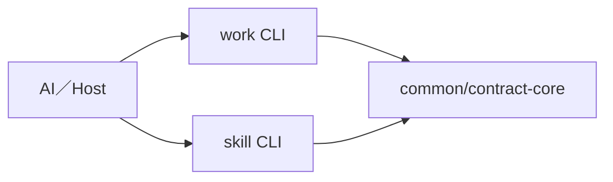
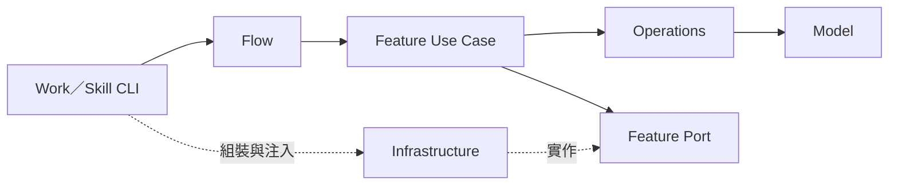

# Rust Workspace 架構規範

## 1. 架構定位

本文件定義 Rust Workspace 的目標架構、職責、依賴方向、資料權威及必要約束，作為開發、重構及審查依據，不描述目前實作的完成程度。

## 2. 領域架構

| 領域 | 職責與邊界 |
| --- | --- |
| AI／Host | 啟用 Skill、選取 Instruction、管理上下文、決定工作順序及下一步、授權與執行外部工具、觀察結果並提出驗收結論；不以未保存的回報改變 Work 正式狀態。 |
| Work | 管理正式紀錄、關聯、狀態與歷史；不接管外部工作流程、指令路由、上下文選取、工具授權、執行或驗收決策。 |
| Skill | 提供通用 Instruction 按需探索、祖先解析、載入、來源驗證、去重、組合及增量載入；不決定語意適用性或管理 Work 正式紀錄。 |
| common/contract-core | 提供共用契約處理、Registry 建立／查詢、Scaffold 及結構驗證機制；不持有領域契約、業務驗證、領域 Parser 或 Host Routing／授權權威。 |

Work 與 Skill 為獨立 Rust 領域，各自提供 CLI 公開入口。移除 Tooling Rust 領域及 `skill-api`，Skill 新增 `skill-cli`、`skill-flow`；Tooling 仍為獨立 Runtime Skill。Work 與 Skill 不得直接或間接依賴對方的任何 Library Crate（含 build、dev、重新匯出），亦不以彼此 CLI 作為內部流程依賴；Host 經公開 CLI 協作。兩領域可依實際責任使用 `common` 的通用能力，common 不得反向依賴領域或形成跨領域資源、契約或執行依賴。

Work 驗證正式紀錄的格式、來源與關聯、版本、保存完整性及狀態規則，保存原始需求、確認決策、外部回報及驗收結論；外部執行、AI 審查及指定使用者確認須有明確來源。Work 不自行判斷外部執行真實性或外部驗收是否通過；正式紀錄操作限制不等同 Host 工具授權。移除強制 Hierarchy Selection、Instruction Selection、Skill Selection 正式綁定、衍生指紋與 Routing Catalog；正式需求中指定的技術或規範限制仍須保存，實際使用來源可作為必要證據。

Work 正式狀態與歷史查詢以已保存的正式紀錄為唯一權威。已發布的正式歷史不可覆寫，目前狀態依領域契約更新，錯誤結果以新增修正紀錄處理。Work 管理 Source、Discussion、TASK、Execution、Attempt、Requirement／TASK Acceptance、Revise、Correction 及 Recovery，各紀錄的職責與規則見 [Skill 架構](../skills/architecture.md) 第 4 節；Work 不提供資料 Migration 功能或公開契約，也不支援舊版 CLI、Schema 或資料格式。Skill 的指令操作不建立或變更 Work 正式紀錄，失效來源僅影響相依操作。

Skill 使用統一 Root／Node／Reference 階層模型及文件格式契約，每個採用指令階層的 Skill 只有直接位於其 `instructions/` 的單一 Root；Work 的 Task、Execute 為子節點，不保留 Work 的 general 特殊 Root、模式專屬 Root 或 Workflow 專屬載入機制。普通 Runtime 探索只讀直接子節點 Metadata，不全樹掃描或建立持久化 Metadata Index。按選取集合解析完整祖先、適用 Reference 與 Module，驗證來源、去重與增量載入；集合異動須重新驗證完整候選，不強制 SHA 或 Fingerprint。

Skill 提供 Shared Bootstrap／選用 Module 的通用來源驗證與載入能力。Shared 及每個啟用的 Skill 各自具備明確合法來源邊界，Shared 不屬於 Skill 指令樹；僅接受同一有效安裝的 Shared 資源與指定的 Skill 來源，Module／Reference 不得任意跨界或經連結逃逸，其他 Skill 按 Host 啟用分別處理。同一有效 Shared 來源可跨 Skill 去重及增量重用，不建立跨 Skill 的繼承、持久化上下文或正式選取權威。Host 負責初始入口解析、適用性、語意衝突與上下文切換；Rust 提供確定性事實及驗證，不接管 Host 的語意決策。共用文件契約及 Runtime 使用規則遵循 [Skill 架構](../skills/architecture.md)。

Work CLI 與 Skill CLI 作為共用 Runtime 資源安裝，與 Work、Tooling Markdown Skill 及 Shared 共用 Markdown 資源分離，不由 Skill 專屬目錄持有 binary；部署責任遵循 [Installer 架構](../release/installer-architecture.md)。

## 3. 分層架構

### 3.1 分層職責

Work 與 Skill 均採 CLI、Flow、Feature、Operations、Infrastructure、Model 六個分層 Crate，遵循相同職責、依賴方向與 Port／Adapter 規範；不另設領域 API Crate。

| 分層 | 職責 |
| --- | --- |
| Model | 資料型別、公開資料形狀及型別基本不變條件。 |
| Operations | 不依賴外部系統的純規則、跨欄位驗證及衍生運算。 |
| Feature | 業務用例、決策、狀態、政策及所需 Port。 |
| Infrastructure | 技術事實、外部資源操作及 Adapter 實作。 |
| Flow | 本領域用例的編排或委派、流程脈絡傳遞。 |
| CLI | 公開入口、輸入輸出邊界、依賴組裝及公開錯誤映射。 |

依責任而非函式是否純粹決定分層；特定用例的業務決策可留在 Feature，不強制將所有純函式移至 Operations。

所有 Work／Skill 公開業務命令遵循 CLI → Flow → Feature Use Case，不得繞過 Flow；單一 Use Case 可由 Flow 直接委派，不增加空轉層。各 CLI 的 Help、參數解析及純公開契約查詢屬入口職責，不為形式新增業務用例。

### 3.2 Crate 依賴矩陣

以下為 Work、Skill 各自允許直接依賴的同領域 Crate。未列出的同領域依賴不允許，只加入實際需要的依賴。

| Crate 分層 | 允許直接依賴的同領域分層 |
| --- | --- |
| Model | 無 |
| Operations | Model |
| Feature | Model、Operations |
| Infrastructure | Model、Operations、Feature |
| Flow | Model、Feature |
| CLI | Model、Flow、Infrastructure |

Flow 不直接呼叫 Operations 或 Infrastructure。重新匯出、測試、build-dependencies 及 dev-dependencies 不得繞過依賴方向及領域邊界。

### 3.3 Port／Adapter

Feature 依業務需要定義 Port，透過 Port 使用外部能力，不直接依賴 Infrastructure。Infrastructure 實作 Port，由 CLI 組裝及注入；Infrastructure 可使用 Operations 的純規則處理技術資料，但不接管業務授權、交易內容、狀態政策或反向呼叫 Feature 取得業務決策。Infrastructure 內部技術操作不強制抽象化。

圖示為公開業務路徑與組裝關係，完整 Crate 依賴以矩陣為準。

## 4. 公開契約與資料流

1. 各領域持有自身公開契約、Rust 型別、驗證及命令樹的權威。契約、Schema、Example 與 Scaffold 資源歸屬各領域 Model，命令樹、Parser 與 Help 歸屬 CLI。各 CLI 僅提供自身契約的 List、Describe、Scaffold、Example 查詢，使用 `contract-core` 共用能力；不建立獨立 Contract CLI、API 或跨領域集中式 Registry。contract-core 不接管領域 Parser，不在建置或 Runtime 直接讀取其他領域資源，不持有第二份領域契約。
2. 公開 JSON 於入口解析為明確 Rust Model 型別，各層傳遞型別化請求及結果，於公開邊界轉換輸出。Rust Workspace 所有 Crate（含 Infrastructure、contract-core、建置與測試程式）均禁止使用 `serde_json::Value`，不提供例外；通用 JSON 處理也須使用明確型別，不得以其他無明確資料契約的動態型別規避。
3. 公開命令、Parser、Help、CLI 查詢、Schema ID、Serde 欄位及字面值、Registry、Example 與 Scaffold 須一致，避免重複維護相同定義。Schema ID 依領域管理並保持明確識別；資源引用與 Schema 內部引用遵守各自有效契約。不得強制 Metadata 驅動 Parser 或 Help，不限制具體型別名稱、資源檔案路徑或一致性實作方式。契約查詢不代替業務驗證或批准，Generated Request 不得由呼叫端自行以 Scaffold 或 Example 代替正式產生流程。
4. 錯誤依呼叫邊界向上傳遞及轉換，下層不得依賴上層錯誤型別。Model 表達型別錯誤，Operations 表達純規則錯誤，Infrastructure 表達技術失敗並依 Port 契約回傳，Feature 賦予業務語意，Flow 補充流程脈絡，CLI 映射公開錯誤契約（如 exit code、reason_code）。不強制每層建立獨立錯誤型別。

## 5. 交易與資料一致性

1. Feature 決定業務交易邊界、Write Plan、候選及業務復原政策；Infrastructure 執行互斥、資料寫入、必要回讀驗證及技術復原，不得自行修改寫入計畫。
2. 依各正式資料的儲存契約保護資料一致性及必要的邏輯原子性，未完成的交易不得視為有效結果。失敗須具備必要安全復原能力；復原資料須符合原操作的正式候選與保存規則，不限制 Journal 或復原的具體實作方式。
3. Preview／Apply 僅適用既有需要批准候選的流程，保留批准與實際審查候選的明確綁定、版本與候選一致性、必要短鎖及 Readback。不強制使用 Fingerprint、SHA 或特定綁定技術；不得以可變候選識別代替實際批准內容及相依資料的重驗。重讀、核對、寫入及回讀須在同一必要互斥保護範圍內完成；批准、候選或版本衝突時拒絕套用。
4. 不因寫入或資料一致性需求，強制所有操作使用 Preview／Apply、同一 Journal 或通用交易框架。

## 6. 模組與測試

每個 Crate 按用途組織目錄，依實際需求建立。

| 位置 | 職責 |
| --- | --- |
| `src/` | 正式程式碼及就近的單元測試。 |
| `resources/` | 正式契約、Schema、Example 及執行時靜態資源。 |
| `tests/` | 整合測試及測試專用輔助程式。 |
| `Cargo.toml` | Crate 定義及依賴。 |

1. 模組按功能與職責組織；多檔模組以 `foo.rs` 搭配 `foo/` 子目錄組織，不使用 `foo/mod.rs`；單檔足夠時不強制拆分。單元測試一律置於 `foo/tests.rs`，由 `foo.rs` 以 `#[cfg(test)] mod tests;` 宣告，不內嵌 `mod tests { ... }`；Crate 根的單元測試置於 `src/tests.rs`。`tests/` 下每個直接的 `.rs` 檔為獨立測試目標，多檔整合測試的共用輔助程式與子模組置於 `tests/<name>/mod.rs`，避免被視為獨立測試目標。不為形式新增模組或 Crate。
2. 僅公開上層實際需要的 Use Case、Port 及型別，不為測試擴大公開 API。單元測試就近放置；跨 Crate 整合測試置於可合法組合受測依賴的上層，所有測試依賴均遵守架構矩陣。
3. 不使用獨立 Fixture 檔案或 `fixtures/` 目錄；所有測試資料、輸入與預期結果由測試程式定義及建立，可使用具明確型別的測試專用輔助函式共用資料。需要檔案或專案樹時，由測試程式建立獨立暫存資料；不得將測試專用資料移入正式資源以規避限制。
4. 測試須可重現，不依賴未受控制的時間、亂數或外部環境。測試資料隨有效的現行契約維護，只驗證現行契約，不測試舊版 CLI、Schema 或資料格式的相容性；具業務、安全或邊界價值的案例依現行語意定義。不得只為使測試通過而修改預期結果。
5. 驗證架構分層、跨領域隔離、公開契約一致性、正式資料與交易完整性、單一 Root 階層、Shared 與 Skill 來源隔離驗證及共用來源去重、增量載入；同步清除不再適用的舊架構測試與資源，不得以保留空殼或降低有效驗收規則替代重構。支援平台的實際 binary 與安裝整合依 Installer 契約驗證。
