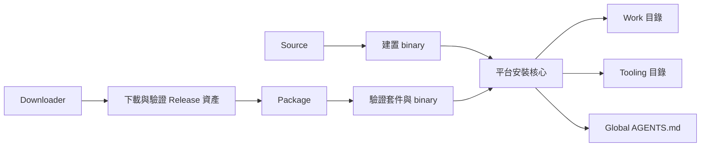

# Work Release 安裝器架構

## 1. 範圍

本文件說明 Windows 與 macOS 的 Work 與 Tooling 安裝入口、模組責任和資料流。使用者操作見 [Release 安裝說明](README.md)；安裝狀態與中斷處理分別見[安裝狀態](install-state.md)和[安裝復原](recovery.md)。

## 2. 三種安裝入口

| 入口 | 取得 Work binary | 交給安裝核心前的責任 |
| --- | --- | --- |
| Source | 從 repository 建置 | 使用原始碼樹中的版本、Skill 與 Global `AGENTS.md` |
| Package | 使用 ZIP 內的預編譯 binary | 驗證套件 manifest、平台與 binary |
| Downloader | 從腳本所屬的固定 GitHub Release tag 下載平台 ZIP | 驗證外部 SHA-256 與 ZIP 內容，再交給 Package |

每個平台各有這三個公開入口。Downloader 負責網路資產的邊界；Package 負責封裝內容的邊界；Source 和 Package 最終進入該平台的安裝核心。Downloader 對安裝選項維持原始引數順序與邊界，由 Package 解析並執行。

## 3. 安裝核心的責任

`os-scripts/common/installer/options.tsv` 是正式選項的共用目錄，兩平台各自解析引數。`os-scripts/common/installer/install-state.json` 是 Source 與 Package 共用的 Work 安裝狀態模板。安裝核心決定 Work、Tooling 與 Global `AGENTS.md` 的目標，讀取有效安裝狀態，完成互動選擇，再執行目標與來源預檢。設定來源與狀態有效性由[安裝狀態](install-state.md)說明。

`state-core` 驗證共同父層狀態；`work-state` 與 `tooling-state` 驗證各自交易期間的暫存狀態。舊版子目錄狀態不作為現有安裝的辨識來源。

目標預檢分別辨識空目錄、由有效父層狀態管理的 Skill，以及未知或不安全內容。沒有有效父層狀態的既有安裝會被保留並拒絕接管。正式寫入前，核心也檢查版本、正在使用的 Work binary 和 Global AGENTS 的取代決策。Global AGENTS 未啟用時，不參與其目標檢查或交易。

Source 在安裝前建置 binary；Package 使用已驗證的預編譯 binary。兩者將完整 Work 指令、binary 與新 Work 狀態放入暫存 Work，並準備完整 Tooling 與其狀態，再透過平台交易模組發布。安裝鎖、正式路徑切換、完成判定和中斷復原由[安裝復原](recovery.md)說明。

## 4. 模組位置

| 責任 | macOS | Windows |
| --- | --- | --- |
| CLI 解析 | `installer/cli/parse-options.sh` | `installer/cli/parse-options.ps1` |
| 父層、Work、Tooling 狀態與目標預檢 | `installer/state/state-core.js`、`installer/state/work-state.js`、`installer/state/tooling-state.js`、`installer/target/preflight.sh` | `installer/state/state-core.ps1`、`installer/state/work-state.ps1`、`installer/state/tooling-state.ps1`、`installer/target/preflight.ps1` |
| 安裝鎖與核心 | `installer/lock/native-lock.c`、`installer/install/install-core.sh` | `installer/lock/mutex.ps1`、`installer/install/install-core.ps1` |
| Work 安裝準備與驗證 | `installer/install/work-install.sh` | `installer/install/work-install.ps1` |
| Work 與 Global AGENTS 交易 | `installer/transaction/work.sh`、`installer/global-agents/transaction.sh` | `installer/transaction/work.ps1`、`installer/global-agents/transaction.ps1` |
| Tooling 安裝準備與驗證 | `installer/install/tooling-install.sh` | `installer/install/tooling-install.ps1` |
| Tooling 交易 | `installer/transaction/tooling.sh` | `installer/transaction/tooling.ps1` |
| 路徑遷移清理 | `installer/install/migration-cleanup.sh` | `installer/install/migration-cleanup.ps1` |

表內路徑分別相對於 `os-scripts/mac/` 與 `os-scripts/windows/`。`.github/scripts/release/` 負責產生與驗證 Release 資產，不參與使用者電腦上的安裝交易。正式入口的引數與退出碼細節保留在 [Issue #95 CLI 契約](../issue-95/cli-contract.md)。
